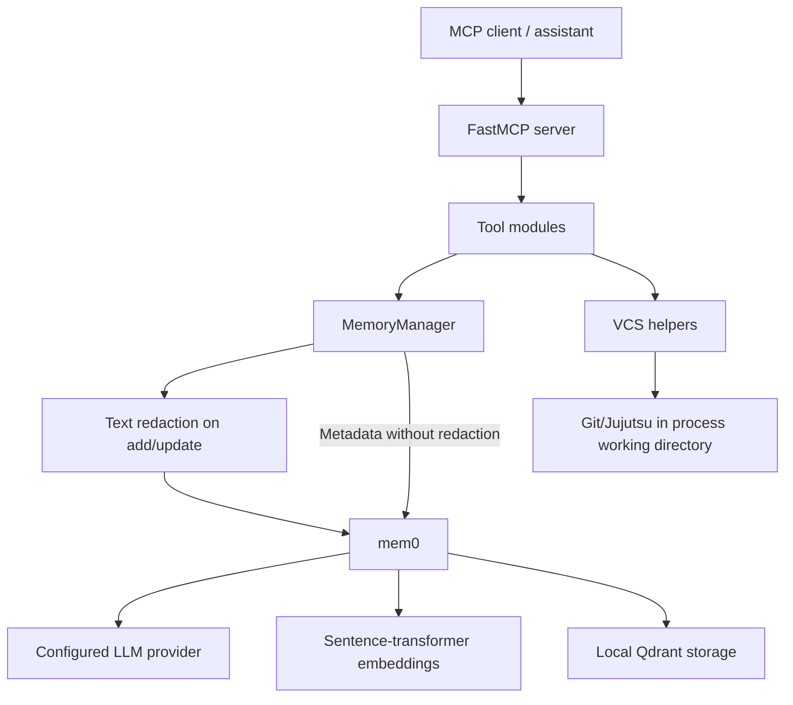

# Architecture: Dotfiles Maintainer MCP

This document describes the retired prototype as implemented. It is not a design guarantee or an active roadmap. See the [case study](docs/CASE_STUDY.md) for the motivation and retrospective.

## Components

| Component | Responsibility |
| --- | --- |
| `server.py` | Registers MCP tools and creates configuration/memory objects during lifespan startup |
| `cli.py` | Typer commands for manual inspection, diagnostics, and memory administration |
| `config.py` | Environment settings and mem0/provider/embedder configuration |
| `core/memory.py` | Wraps mem0 calls, applies text redaction on add/update, and validates responses |
| `core/types.py` | Pydantic request and response models |
| `tools/` | Formats supplied information and orchestrates memory/VCS calls |
| `utils/vcs.py` | Detects Git/Jujutsu and runs subprocesses for status/history |
| `utils/secrets.py` | Best-effort regex replacement of selected secret patterns |
| `prompts/` | Persona/workflow instructions and fact-extraction guidance |

## Data flow

For `commit_contextual_change`, the assistant supplies the change description and rationale. The tool formats those values and metadata, then passes them to `MemoryManager`. The wrapper redacts selected patterns in the text, calls mem0, validates its response, and returns a tool result. The tool neither makes the file change nor independently verifies it. Semantic extraction may produce no new record, or alter existing memories.

Local vector storage does not imply that all processing is local: the configured memory LLM may be a remote service. Provider SDKs and embedding infrastructure are part of the startup/dependency footprint even though many exposed tools are simple record-formatting operations.

## Boundaries and known limitations

**Configuration:** `DOTFILES_LLM_KEY` is the explicit key setting. Provider-specific environment-variable autodetection overwrites explicit provider/model choices unless that setting is nonempty. See [usage](docs/usage.md) for exact names and caveats.

**Repository status:** `check_config_drift` reads Git/Jujutsu status in the server's working directory. It does not compare deployed configuration against a baseline or a dotfiles manager's source. Baseline metadata does not select the repository. Clean Jujutsu prose can be interpreted as changed files, and an empty memory-write result can discard the detected status details. The name “drift” is broader than the implementation.

**Memory semantics:** supplied baseline data and retrieved memories are context, not verified ground truth. Roadmap filters are search phrases; trial minimum age is ignored. Search errors or invalid response shapes may be represented as empty results, so an empty result does not always mean that no relevant record exists.

**Sensitive data:** only add/update text passes through the regex helper. Metadata is not sanitized, and the helper misses complete private-key bodies and some structured credentials. Its output is not safe to assume secret-free. See [SECURITY.md](SECURITY.md).

**Lifecycle:** the MCP lifespan constructs a shared memory object. Its shutdown block logs shutdown but does not explicitly close the underlying resources. This is a prototype integration boundary, not a completed operational lifecycle design.

## Working on a fork

A new tool belongs in `tools/` with registration in `server.py`. Changes to memory behavior belong in the wrapper/configuration boundary; VCS behavior belongs in the helper. Before extending the tool catalog, establish an actual workflow and tests for configuration precedence, repository targeting, provider failure, and semantic versus deterministic state. See [development notes](CONTRIBUTING.md).
